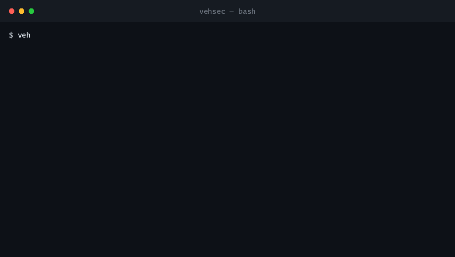
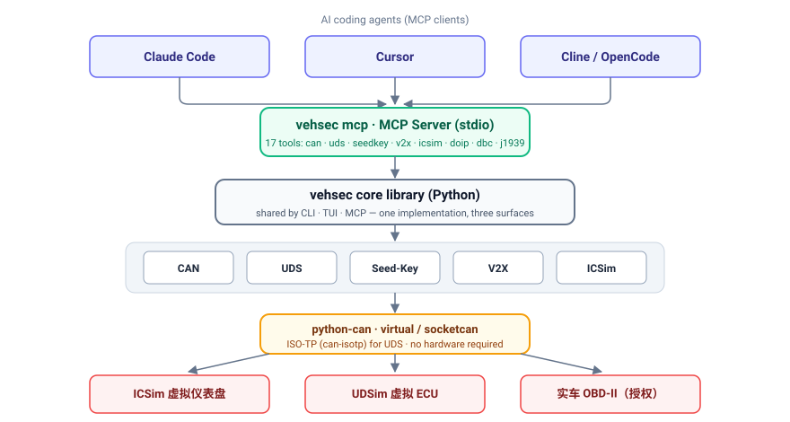

# vehsec — Vehicle Security Toolkit

> CAN · UDS · Seed-Key · V2X · ICSim · **DoIP** · **DBC** — wrapped as a **CLI**,
> a **TUI**, and an **MCP server** so you (or an AI coding agent) can drive it.
> **No car required.**

[](https://github.com/xuange-hu/vehsec/actions/workflows/ci.yml)
[](tests/)
[](LICENSE)
[](https://www.python.org)
[](https://modelcontextprotocol.io)

[中文 README / Chinese version](README_CN.md) · [Attack playbook](docs/playbook.md) · [Launch copy](docs/promotion.md)



---

## Why

Vehicle / in-vehicle-network (IVN) security is one of the hottest areas in security
research — and one of the most fragmented. The classic tools (CANalyzat0r, UDSim,
CANToolz, ICSim, caringcaribou) are aging, Shell-heavy, and thinly documented, so
**a beginner cannot get started without a real car**.

`vehsec` folds those capabilities into one modern, documented, composable package:
one command, one TUI, or one sentence to an AI agent gets you a UDS handshake, a CAN
replay, a Seed-Key solve, a V2X signature analysis, or an instrument-cluster tamper
demo. Everything runs on a **virtual CAN bus** (`python-can virtual`, or `vcan0` +
ICSim on Linux) with Docker labs — nothing to brick.

## Architecture



One core library, three surfaces (CLI / TUI / MCP), one transport. The same
implementation is exposed to humans *and* to AI agents — that is the main difference
from the older tooling.

## Quick start

**Option A — one line, no clone, no venv** (best for handing the MCP server to an agent):

```bash
uvx --from "vehsec[mcp] @ git+https://github.com/xuange-hu/vehsec" vehsec-mcp
uvx --from "vehsec @ git+https://github.com/xuange-hu/vehsec" vehsec --help
# no uv? pipx run --spec "vehsec[mcp] @ git+https://github.com/xuange-hu/vehsec" vehsec-mcp
```

The `@ git+…` form installs straight from this repository, so it works today.
Once the package is on PyPI it shortens to `uvx --from "vehsec[mcp]" vehsec-mcp`;
`.github/workflows/publish.yml` publishes automatically on every release, it only
needs PyPI Trusted Publishing enabled **once**.

**Option B — clone and hack on it:**

```bash
git clone https://github.com/xuange-hu/vehsec && cd vehsec
python -m venv .venv && source .venv/bin/activate      # Windows: .venv\Scripts\activate
pip install -e ".[all]"

vehsec --help             # CLI
vehsec tui                # interactive TUI
vehsec mcp                # MCP server (stdio) for AI agents
vehsec mcp --check        # list the 31 tools an agent would get, then exit
python examples/demo.py   # 5-step scripted demo, no hardware
```

## Let an AI agent drive it

Drop this into your agent's MCP config (`~/.workbuddy/mcp.json`, Cursor
`~/.cursor/mcp.json`, Cline, or Claude Desktop's `claude_desktop_config.json`) and
trust the server — no clone, no venv, `uv`/`uvx` fetches it on first launch:

```json
{
  "mcpServers": {
    "vehsec": {
      "command": "uvx",
      "args": ["--from", "vehsec[mcp] @ git+https://github.com/xuange-hu/vehsec", "vehsec-mcp"]
    }
  }
}
```

Already have `vehsec` installed? The equivalent is
`{ "command": "vehsec", "args": ["mcp"] }` (`examples/mcp-config.json`). Then just ask:

> "Run a UDS security access on the virtual ECU and show me the seed and key."

Thirty-one tools are exposed: `can_send`, `can_fuzz`, `can_analyze`,
`uds_security_access`, `uds_read_did`, `uds_read_dtcs`, `uds_clear_dtcs`,
`uds_decode_dtc`, `uds_raw`, `seedkey_solve`, `seedkey_vendors`,
`seedkey_recover`, `seedkey_predict`, `v2x_analyze`, `icsim_set_speed`, `icsim_tamper_demo`,
`doip_simulate`, `doip_probe`, `doip_tls_audit`, `doip_tls_probe`, `doip_tls_simulate`,
`dbc_decode`, `dbc_info`,
`j1939_decode`, `j1939_encode`, `j1939_decode_name`, `j1939_decode_dm1`,
`isotp_segment`, `isotp_decode`, `isotp_reassemble`, `isotp_explain`.

## Capabilities

- **UDS diagnostics** — session control, security access (27), DID read/write, routine
  control, ECU reset, **DTC read/clear (19/14)**, communication control (28), and a
  **raw request escape hatch**, over ISO-TP (`udsoncan` + `can-isotp`). Ships with an
  attached **virtual ECU**, so all of it runs with nothing plugged in.
- **CAN replay & fuzz** — replay `candump` logs, or mutate frames against a set of IDs.
- **CAN ID discovery** — per-ID counts, unique payloads, and *which bytes change*, to
  locate the control signal in an unknown vehicle.
- **Seed-Key solver** — pluggable algorithm registry (xor / add / rotate / bit-reverse /
  nibble-swap / endian-swap / CRC16-mixed / LFSR / SHA-256 keystream) for the UDS 27
  handshake, plus **algorithm recovery**: feed it observed `(seed, key)` pairs and it
  brute-forces the transform family and solves for the parameters — then
  `seedkey_predict` / `seedkey.predict()` applies the result to a **fresh seed** you
  never observed, which is how you unlock the next session without the OEM DLL.
- **V2X / ECDSA** — detect nonce reuse and **recover the signer's private key**.
- **ICSim control** — script speed / doors / turn signals on the virtual cluster.
- **DoIP (ISO 13400)** — in-process virtual DoIP entity: vehicle discovery, routing
  activation, and UDS-over-Ethernet (read the VIN) with no hardware.
- **DoIP over TLS** — the ISO 13400-2 secure diagnostics channel (TCP 3496), plus a
  **certificate audit engine**: a from-scratch, zero-dependency X.509 reader that also
  verifies RSA PKCS#1 v1.5 signatures in pure Python, so "self-signed" is proven rather
  than guessed. Grades key size, signature hash, validity, SAN/hostname and CA chain,
  and probes which TLS versions a gateway still accepts.
- **DBC parsing** — pure stdlib: Intel/Motorola endianness, signed values,
  factor/offset scaling, value tables, multiplexed signals.
- **J1939 (trucks/buses)** — 29-bit id ↔ PGN/priority/source (PDU1 & PDU2), NAME
  decode, DM1 diagnostics (SPN/FMI/CM/OC), EEC1 engine speed.
- **ISO-TP (ISO 15765-2)** — the UDS transport layer, from scratch: SF/FF/CF/FC
  framing, segmentation and reassembly with sequence validation, and an
  **ASCII visualisation** of the whole transfer.
- **DTC (diagnostic trouble codes)** — read faults (19 sub 01/02/0A), clear them
  (14), and decode the 3-byte code into its SAE J2012 identifier (`C10000` →
  `U0100`) with status flags and a short description.

## Labs — 5 runnable Docker exercises

| Lab | Topic |
|-----|-------|
| [`labs/uds-did-decrypt`](labs/uds-did-decrypt) | UDS DID decryption: identify the cipher, recover the key |
| [`labs/delta-forge-patchchain`](labs/delta-forge-patchchain) | OTA patch-chain diff reveals a hidden payload |
| [`labs/v2x-ecdsa-nonce`](labs/v2x-ecdsa-nonce) | ECDSA nonce reuse → private-key recovery |
| [`labs/sentinel2-can-statemachine`](labs/sentinel2-can-statemachine) | CAN state-machine injection / missing auth guard |
| [`labs/seedkey-recover`](labs/seedkey-recover) | UDS 0x27 Seed-Key: reverse the algorithm from 5 sniffed pairs, then unlock with an unseen seed |

```bash
python labs/v2x-ecdsa-nonce/solve.py --gen 20   # nonce reuse is the default:
                                                # the first run recovers the key
python labs/v2x-ecdsa-nonce/solve.py --gen 20 --no-reuse   # contrast: nothing found

# Lab 5 needs no third-party package — pure stdlib + vehsec.seedkey
python labs/seedkey-recover/solve.py            # 5 pairs -> one algorithm -> flag
python labs/seedkey-recover/solve.py --pairs 1  # too little evidence -> 0x7F 27 35
```

## UDS in 30 seconds — no hardware

Every UDS command talks to an attached **virtual ECU** on a `python-can` virtual
bus, so the UDS stack (ISO-TP segmentation, flow control, Seed-Key) is exercised
for real — just without metal.

```console
$ vehsec uds read --did 0xF190
{'did': '0xF190',
 'value': '5756575a5a5a314a5a5857303030303031',
 'ascii': 'WVWZZZ1JZXW000001'}

$ vehsec uds security --level 1 --vendor training_rotate
{'level': 1, 'seed': '01020304', 'key': '585e5c52', 'unlocked': True}

$ vehsec uds write --did 0xF190 --data 0102030405
{'did': '0xF190', 'written': 5}
```

## Diagnostic trouble codes in 30 seconds

```console
$ vehsec uds dtc                       # read faults (service 0x19 sub-function 02)
        Diagnostic Trouble Codes (3)
┌───────┬────────┬─────────┬──────────────────────────┬──────────────────────┐
│ code  │ raw    │ status  │ flags                    │ description          │
├───────┼────────┼─────────┼──────────────────────────┼──────────────────────┤
│ P0100 │ 010000 │ 0x2C    │ pendingDTC,confirmedDTC… │ Mass or Volume Air … │
│ P0420 │ 042000 │ 0x0C    │ pendingDTC,confirmedDTC  │ Catalyst System Eff… │
│ U0100 │ C10000 │ 0x08    │ confirmedDTC             │ Lost Communication … │
└───────┴────────┴─────────┴──────────────────────────┴──────────────────────┘

$ vehsec uds dtc --status 0x08         # confirmed faults only
$ vehsec uds dtc --count               # just the number stored
$ vehsec uds dtc --clear               # service 0x14
$ vehsec uds raw --data 1901FF         # any request, response returned verbatim
590109000003
```

Three records are 15 bytes, so this response is carried by a first frame plus
consecutive frames — the ISO-TP path is the real one, not a stub.

## ISO-TP in 30 seconds

The VIN response is 20 bytes, so it is carried by a first frame plus two
consecutive frames. `vehsec isotp explain` draws exactly how:

```console
$ vehsec isotp explain --data 62F1904142434445464748494A4B4C4D4E4F5051
ISO-TP (ISO 15765-2) — 20-byte payload carried by 3 classic CAN frame(s)

  #   frame bytes             PCI   kind  detail
  0   10 14 62 F1 90 41 42 43 0x10  FF    total=20 B, carries bytes 0..5
  1   21 44 45 46 47 48 49 4A 0x21  CF    seq=1, carries bytes 6..12
  2   22 4B 4C 4D 4E 4F 50 51 0x22  CF    seq=2, carries bytes 13..19

  reassembled payload:
    62 F1 90 41 42 43 44 45 46 47 48 49
    4A 4B 4C 4D 4E 4F 50 51
    = 20 bytes
```

Point it at metal or UDSim instead with
`VEHSEC_CAN_IFACE=socketcan VEHSEC_CAN_CHANNEL=vcan0` plus `auto_ecu=False`.

## Seed-Key algorithm recovery in 30 seconds

Real ECUs hide their seed→key algorithm in an OEM DLL. Capture a few
`(seed, key)` pairs (replay `27 01`, log what the official tool answers with)
and let `vehsec` work out the transform:

```console
$ vehsec seedkey recover --pairs 11223344:4B78691E,a5b6c7d8:FFEC9D82,deadbeeF:84F7E4B5
    Recovered candidates (high confidence, 3 pair(s), 4-byte seed)
┌─────────────────────────┬────────────────────┐
│ algorithm               │ key for first seed │
├─────────────────────────┼────────────────────┤
│ key[i] = seed[i] ^ 0x5A │ 4B78691E           │
└─────────────────────────┴────────────────────┘
```

The catalogue covers `xor c`, `add c`, `sub c`, `xor i ^ c`, `add i + c`,
`rotl 1/3 ^ c`, `bitrev ^ c`, `nibble-swap ^ c`, endian-swap, and the affine
family `a*seed[i]+b`. Every result is checked against **all** supplied pairs, so
three or more pairs usually collapse to a single answer. Same thing over MCP:
`seedkey_recover(pairs="11223344:4B78691E,...")`.

Recovery is only interesting if it ***generalises*** — a candidate that happens to
fit one observation will fail on the next session. `seedkey predict` (CLI, MCP
`seedkey_predict`, or `vehsec.seedkey.predict()`) applies the recovered algorithm
to a seed you never captured:

```console
$ vehsec seedkey predict --pairs 11223344:4B78691E,a5b6c7d8:FFEC9D82,deadbeeF:84F7E4B5 \
                         --seed 00112233
algorithm key[i] = seed[i] ^ 0x5A
key      5A4B7869  (high confidence, 3 pair(s))
```

[Lab 5](labs/seedkey-recover) turns this into a full exercise: five sniffed pairs,
held-out seed, real `0x27 01/02` handshake, and a protected DID behind it —
including the failure mode where too little evidence survives the fit but not the
unlock (`--pairs 1`).

## DoIP & DBC in 30 seconds

```bash
vehsec doip simulate                       # spin up a fake DoIP ECU, read its VIN
vehsec dbc info    --file examples/sample.dbc
vehsec dbc decode  --file examples/sample.dbc --id 0x100 --data 9F01393000010000
#   Speed 41.5 km/h · Odometer 1234.5 km · SpeedValid 1
vehsec dbc encode  --file examples/sample.dbc --id 0x100 --set Speed=41.5
vehsec dbc watch   --file examples/sample.dbc --log capture.log   # decode a whole capture
```

## DoIP TLS / gateway certificates in 30 seconds

```bash
# 1. a TLS DoIP gateway in-process: handshake, routing activation, UDS, then audit
vehsec doip tls-simulate
#   negotiated TLSv1.3 / TLS_AES_256_GCM_SHA384
#   UDS 22 F190 -> 62f1905756575a5a5a314a5a5857303030303031
#   STRONG score 100/100

# 2. audit a certificate you captured (PEM or DER)
vehsec doip tls-audit --file gateway.pem --ca oem-ca.pem --hostname gateway.local
#   REJECT score 10/100 grade F
#     [CRITICAL] RSA key is only 1024 bits
#     [HIGH    ] signed with SHA1 (sha1WithRSAEncryption)
#     [MEDIUM  ] no subjectAltName extension; the CN is the only identity

# 3. audit a live gateway: TLS versions + cert + is plaintext 13400 still open?
vehsec doip tls-probe --host 192.0.2.10
```

The interesting finding is usually the last one: **a gateway whose plaintext port 13400
still accepts a routing activation makes its own TLS listener decorative.** The audit
also tries each TLS version on its own, which is how you find a gateway that still
answers TLS 1.0.

## Docs

| Doc | What |
|-----|------|
| [Attack playbook](docs/playbook.md) | Recon → UDS → Seed-Key → replay → V2X, with an ISO/SAE 21434 TARA map |
| [Quickstart](examples/quickstart.md) | Install, CLI, TUI, MCP setup |
| [Roadmap](ROADMAP.md) | What's next |
| [Contributing](CONTRIBUTING.md) | Dev setup, tests, how to add a lab |
| [Security policy](SECURITY.md) | Reporting vulnerabilities in vehsec itself |
| [awesome-vehicle-security.md](awesome-vehicle-security.md) | Curated resource list |

## Tests

```bash
pip install -e ".[all]" && pip install pytest
pytest -q      # 261 passed: core, CLI, MCP registration, all 5 labs, demo script
```

CI runs ruff + pytest on Python 3.11 / 3.12 / 3.13.

## Legal & ethics

For **authorized security research, teaching, and testing on equipment you own only**.
Do not point this at vehicles or networks you are not authorized to test; comply with
your jurisdiction's laws. The authors accept no responsibility for misuse.

## License

MIT © xuange-hu
